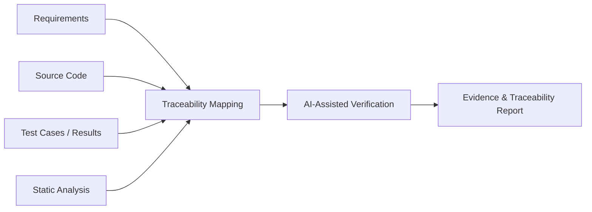

# SpecTrace

**Academic Major Project — AI-Assisted Software Verification & Requirements Traceability**

SpecTrace is a final-year Computer Engineering project exploring how software requirements can be mapped to implementation artifacts and verified with evidence from testing, static analysis, and AI-assisted review.

## Project Goal

The project is designed around a common software-engineering problem: requirements, implementation, tests, and verification evidence often become disconnected as a system evolves.

SpecTrace aims to provide a traceability layer that can connect:

- software requirements
- source-code modules and functions
- test cases and execution results
- static-analysis findings
- AI-assisted verification notes
- evidence-based status reporting

## Intended Workflow

## Engineering Direction

The project is intended to emphasize:

- requirements-to-code traceability
- test and verification evidence
- static-analysis integration
- structured AI-assisted review
- explainable findings rather than opaque pass/fail output
- reproducible reporting

## Current Status

This repository currently documents the project concept and direction. Implementation work is being developed as part of the academic major-project lifecycle.

The README intentionally distinguishes planned architecture from completed implementation; features will be documented here as they are built and verified.

## Author

**Pranay Eligeti**  
[LinkedIn](https://www.linkedin.com/in/pranay-eligeti) · [GitHub](https://github.com/pranay-eligeti)
